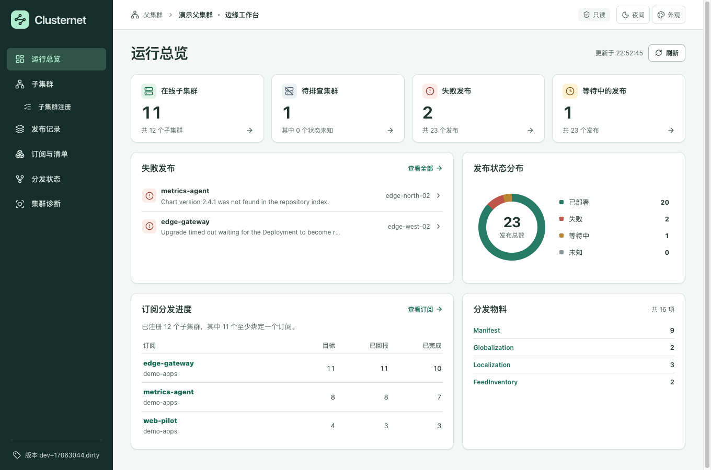
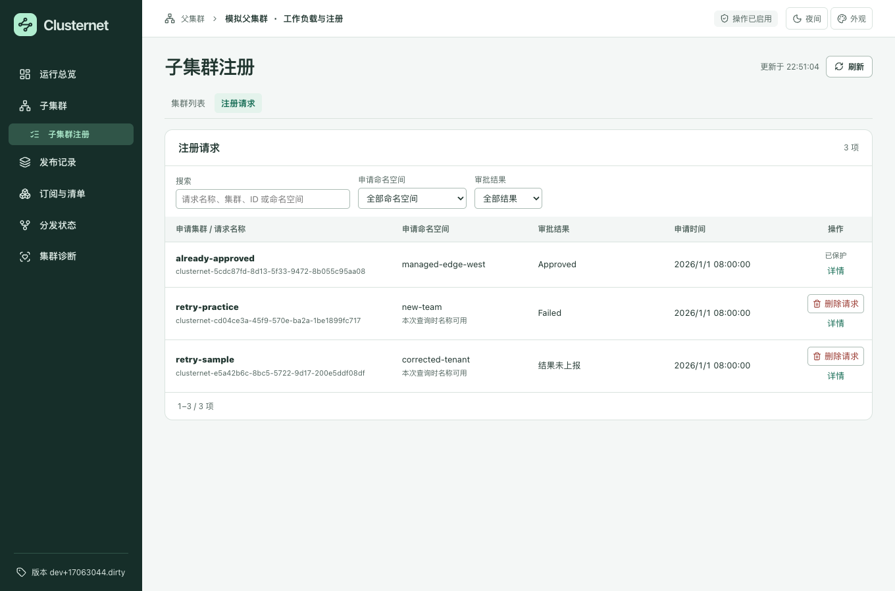
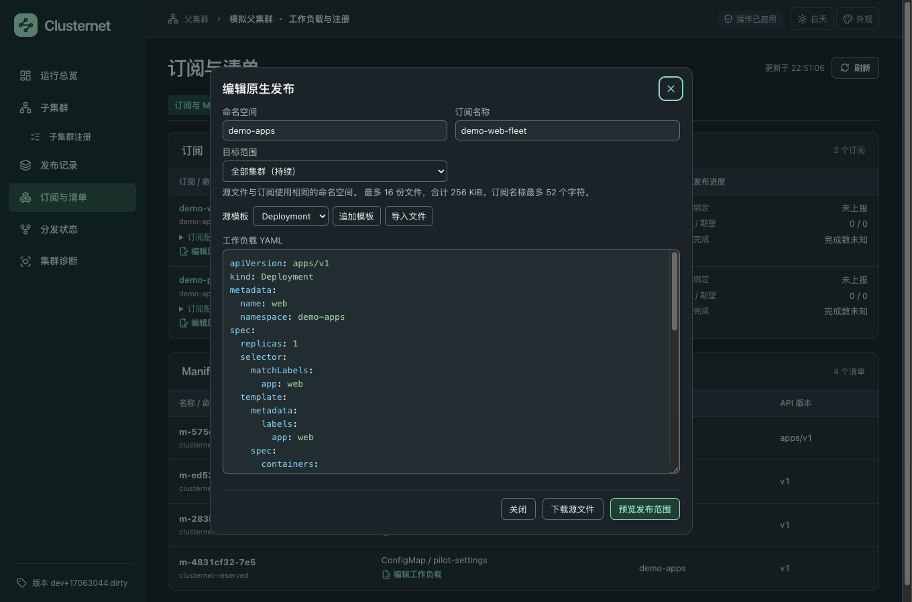
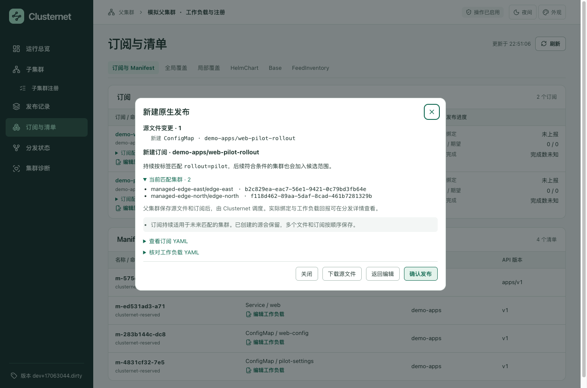

# Clusternet Dashboard

**English** · [简体中文](README.zh-CN.md)

A lightweight operations dashboard for [Clusternet](https://github.com/clusternet/clusternet). Use it to inspect cluster health and distribution, publish Helm charts or native YAML, and follow up on failed releases and cluster registrations. Write operations are opt-in.

Use the dashboard on a Clusternet parent cluster to investigate:

- Cluster readiness conditions, heartbeat intervals, health probes and reported node capacity
- Subscription progress and individual Feed reports from each target cluster
- HelmRelease failures and pending operations, including the owning Description's phase and reason
- Clusternet API resources, control-plane Deployment conditions and read access for dashboard operations
- Cluster registration decisions, subscription selectors and the resources and override rules used for distribution

## Dashboard preview

These screenshots use simulated parent clusters. In the overview, 11 of 12 child clusters are online. Two of the 23 Helm releases have failed, with the release name and reported reason visible alongside subscription progress.



<details>
<summary>Review child-cluster registration requests</summary>

Filter by requested namespace or approval status. Approved requests are protected, while eligible failed requests have a delete action.



</details>

<details>
<summary>Edit a Deployment in the YAML editor</summary>

This Deployment belongs to a subscription that continuously targets all clusters. The editor highlights YAML and links syntax errors to their line and column.



</details>

<details>
<summary>Preview which clusters will receive a change</summary>

The preview for a new ConfigMap shows two clusters matching `rollout=pilot`. New clusters with that label also become candidates for distribution.



</details>

## Security model

The default installation provides read-only access.

- The browser never receives Kubernetes credentials and never talks directly to the Kubernetes apiserver.
- The backend talks to Kubernetes using the configured kubeconfig in local development or an in-cluster ServiceAccount in Kubernetes.
- The Helm chart creates read-only RBAC by default.
- Label editing grants `patch` on ManagedClusters. Failure follow-up grants `get` and `patch` on one ConfigMap in the release namespace. Chart version editing grants `patch` on HelmCharts across namespaces. Failed-release deletion separately grants `delete` on individual HelmReleases across namespaces. The chart omits `deletecollection`. Deploying a chart grants `create` on Subscriptions through a separate switch. Native publishing and registration withdrawal have separate RBAC switches. All visitors share the dashboard's Kubernetes identity. Restrict access to each enabled operation at the gateway. See the [security policy](SECURITY.md).
- The dashboard does not include authentication in the first version. Deploy it behind a trusted network boundary such as VPN, private ingress, ingress authentication, or an existing identity-aware gateway.

Do not expose the dashboard publicly without authentication.

## Install or upgrade with Helm

Point your kubeconfig at the Clusternet parent cluster. The OCI chart installs the matching image `docker.io/changxuan/clusternet-dashboard:v0.2.0`. Run the same command for a first install or an upgrade, using the existing release name and namespace when upgrading.

```bash
helm upgrade --install clusternet-dashboard \
  oci://registry-1.docker.io/changxuan/clusternet-dashboard \
  --version 0.2.0 \
  --namespace clusternet-system --create-namespace
```

**Upgrading a customized installation?** Pass your reviewed values file with `--reset-values -f dashboard-values.yaml` to apply your settings on top of the new chart defaults. Retrieve your current overrides with `helm get values clusternet-dashboard -n clusternet-system -o yaml` and remove any old `image.tag` override so Helm selects the matching image.

The default Service is ClusterIP. Open a port-forward, then visit the [local dashboard](http://localhost:8080/clusternet/).

```bash
kubectl -n clusternet-system port-forward svc/clusternet-dashboard 8080:80
```

For a private Ingress, add these settings to your values file and pass it with `-f dashboard-values.yaml`. Replace `nginx` with your controller's IngressClass.

```yaml
ingress:
  enabled: true
  ingressClassName: nginx
  path: /clusternet
```

To install the chart from a release checkout, replace the OCI reference with `./charts/clusternet-dashboard` and omit `--version`. The source chart also pins the release image. [Chart defaults](charts/clusternet-dashboard/values.yaml)

### Workspace name and optional operations

For development builds, use a chart and image from the same revision.

```yaml
env:
  parentClusterName: "Operations hub"
labelEditing:
  enabled: false
releaseOperations:
  triage: false
  chartVersionEditing: false
  deleteFailedRelease: false
  deployCharts: false
  editChartSources: false
  publishNativeWorkloads: false
registrationOperations:
  deleteFailedRequests: false
```

Locally, the header shows the selected kubeconfig context. Set `KUBE_CONTEXT` to select a context for this dashboard process while keeping your current kubectl context. An in-cluster installation shows **集群内连接** unless you supply `env.parentClusterName`. The sidebar shows the version embedded in the running binary. Release builds use the image's release tag and source builds show a development identifier.

With editing enabled, open **子集群 → 编辑标签** to add, change or remove labels. Label selectors can change which subscriptions and overrides match a cluster. The editor checks the object's UID and the original values of edited labels when saving. If another operator changes the same label, reload the cluster and review the change.

Set the switches you need to `true`. For a local binary, the corresponding environment variables are `ENABLE_LABEL_EDITING`, `ENABLE_RELEASE_TRIAGE`, `ENABLE_CHART_VERSION_EDITING`, `ENABLE_FAILED_RELEASE_DELETION`, `ENABLE_CHART_DEPLOYMENT`, `ENABLE_CHART_SOURCE_EDITING`, `ENABLE_NATIVE_PUBLISHING` and `ENABLE_FAILED_REGISTRATION_DELETION`.

- **Failure follow-up**. Open a failed release under **发布记录** to mark the incident as investigating or resolved, or reopen it. Team members see the same status and can filter the failure list. Follow-up updates a dedicated ConfigMap and leaves the Helm workload untouched. A newly reported, distinct failure starts open.
- **Deleting a failed release for redeployment**. Open the failed release under **发布记录** and review the target cluster, namespace and release before confirming deletion. This requests normal Kubernetes deletion of one HelmRelease. Its finalizer can uninstall the workload in the target cluster and interrupt service. The dashboard checks that the release is still failed and that its active controlling Description has the same UID as its owner reference and still declares the chart.
- **HelmChart impact and version changes**. In a read-only workspace, open **订阅与清单 → HelmChart → 查看影响范围** to see all directly referencing subscriptions, their reported binding counts and the deduplicated target list. With version editing enabled, **更改 Chart 版本** shows the same preview and lets you confirm a new exact version. This updates the source HelmChart's `spec.version` and can roll out to healthy targets too. Verify the version in the chart repository first, then check the release reports for deployment results. Scheduling and overrides can change the effective rollout.

- **Deploying a chart**. Under **订阅与清单 → HelmChart**, choose a source, enter a subscription name (up to 52 characters), select a scope and review the preview. The dashboard creates a Replication Subscription in the source namespace. The installation namespace comes from `spec.targetNamespace` on the chart.
  - **Specific clusters** saves the selected registration IDs. Selecting all current search results also produces a fixed list.
  - **Label selector** saves a Kubernetes rule such as `env=prod,region in (east,west)`. Newly registered or relabeled clusters that match become scheduling candidates.
  - **All clusters** saves `clusterAffinity: {}`, covering current and future clusters. Dynamic rules can start with zero matches. The preview checks for subscriptions whose rules could overlap on the same Helm release, including future matches.

  You can inspect and download the exact Subscription YAML from the preview. An empty set of schedulable targets can produce a FailedScheduling event. Check the reported bindings before assuming that an existing installation was removed. Open the created subscription to check its recorded configuration, bound targets and Feed reports. Check the resulting HelmRelease phase on each target. Choose another subscription name if it already exists. If an existing Subscription or HelmRelease manages the same child Helm release, review the existing deployment or choose another cluster. Subscriptions overlapping the same target can contend for the same child Helm release, including same-named source charts in different parent namespaces that use the same child installation namespace. Under upstream v0.14.0, HelmRelease creation also requires the target's AppPusher to be enabled. [v0.14.0 deployment conditions](https://github.com/clusternet/clusternet/blob/v0.14.0/pkg/hub/deployer/helm/helm.go#L219-L246) · [v0.18.1 chart lookup and verification](https://github.com/clusternet/clusternet/blob/v0.18.1/pkg/controllermanager/deployer/deployer.go#L760-L782)

**Authoring deployment files**

The local workload draft, native workload publisher and HelmChart editor highlight YAML as you type. Select an error’s line and column to jump to it. Fix syntax errors before previewing a publication. For a local draft larger than 256 KiB, use **校验 YAML** to check it manually or **下载 YAML** to download the original text.

Enable `releaseOperations.editChartSources` for **新建 HelmChart** and **编辑配置** in the HelmChart catalog. Start from a template, import a YAML file or download your draft. Configure an HTTP(S) or OCI repository, chart name, pinned version, installation namespace, timeout and common installation options. Review field changes, direct subscription references and reported bindings before saving to the parent cluster. Creating a previously missing chart can satisfy an existing subscription. Existing credential references and other fields outside the editor are preserved.

**Publish native workloads.** Enable `releaseOperations.publishNativeWorkloads` (`ENABLE_NATIVE_PUBLISHING=true` for the binary) to create Deployment, Service and ConfigMap files or open an existing source or publication from the Manifest and Subscription lists. A publication accepts multiple YAML documents in one namespace. Choose all clusters, pick labels from registered clusters, or enter a Kubernetes selector. Review source changes, the Subscription and current matches, then confirm. Provision the intended namespace on the child clusters when needed. For a NodePort or LoadBalancer Service, leave allocated addresses and ports to the target cluster. A headless Service can specify `clusterIP: None`. The local YAML editor and file download remain available in read-only mode.

The dashboard writes templates through the parent Shadow API, then creates or updates the Replication Subscription. Changes to an already subscribed source can propagate as soon as the source is saved. A multi-resource request can partially succeed. Check the receipt and current resources, then generate a new preview before retrying. A successful receipt acknowledges parent-cluster writes. Use distribution details to check bindings and Feed reports. [Clusternet Shadow API](https://clusternet.io/docs/user-guide/clusternet-shadow-api/)

**Cluster registration.** The sidebar shortcut **子集群注册** opens the request list. Filter by requested namespace or approval status and compare the requested namespace with the dedicated namespace and observed occupancy. The registration request itself is cluster-scoped.

Enable `registrationOperations.deleteFailedRequests` (`ENABLE_FAILED_REGISTRATION_DELETION=true`) to withdraw a failed or denied request, or an unapproved request with an explicitly requested namespace. Check the child configuration and resolve namespace conflicts. Choose **删除请求** in the request row and enter the full request name to confirm. The dashboard checks current identity and allocations and deletes one request. It protects approved requests and requests with an associated dedicated namespace or ManagedCluster.

Look for a replacement by cluster ID. The v0.14.0 and v0.18.1 agents poll the existing request while waiting for approval. If no replacement appears, the child operator can restart registration after correcting the configuration, for example by restarting the agent. A new UID distinguishes a new attempt. Check for approval and the corresponding ManagedCluster. [Upstream registration guide](https://clusternet.io/docs/tutorials/cluster-management/checking-cluster-registration/)

Write endpoints accept same-origin JSON requests on loopback or an allowed hostname. The chart includes its configured Ingress hostname in each enabled feature's allowlist. For another gateway, set `labelEditing.allowedHosts` for label edits and `releaseOperations.allowedHosts` for release operations, native publishing and registration withdrawal. For local binaries, the corresponding variables are `LABEL_EDITING_ALLOWED_HOSTS` and `WORKSPACE_WRITE_ALLOWED_HOSTS`. Preserve the incoming `Host` header.

## How to contribute

When [reporting a bug](https://github.com/chxcode/clusternet-dashboard/issues), include the dashboard version, steps to reproduce it, and the expected and observed behavior. For a code or documentation change, start with the [contributing guide](CONTRIBUTING.md).

- [Run the dashboard locally](CONTRIBUTING.md#run-the-dashboard-locally) with or without a Clusternet cluster.
- [Check your changes](CONTRIBUTING.md#verify-your-change) and [open a pull request](CONTRIBUTING.md#open-a-pull-request) against `main`.
- Maintainers can [publish and verify a release](docs/releasing.md). Pushing a version tag publishes a multi-architecture image and an OCI Helm chart to Docker Hub.

Report suspected vulnerabilities privately. See the [security policy](SECURITY.md).

## API endpoints

These endpoints are relative to `BASE_PATH`, which defaults to `/clusternet`. The HelmChart impact preview is available with read-only permissions. Write operations and source-file access require their respective switches.

```text
GET /api/health
GET /api/context
GET /api/namespaces
GET /api/events
GET /api/clusternet/resources
GET /api/clusters
GET /api/registrations
DELETE /api/registrations/{name}
POST /api/native-sources/{namespace}/{name}/{kind}
POST /api/native-workloads/{namespace}/{name}/source
POST /api/native-workloads/{namespace}/{name}/preview
POST /api/native-workloads/{namespace}/{name}/apply
PATCH /api/clusters/{namespace}/{name}/labels
GET /api/subscriptions
GET /api/subscriptions/{namespace}/{name}
GET /api/manifests
GET /api/globalizations
GET /api/localizations
GET /api/feedinventories
GET /api/helmcharts
GET /api/helmcharts/{namespace}/{name}/version-impact
POST /api/helmcharts/{namespace}/{name}/version
POST /api/helmcharts/{namespace}/{name}/deployment-preview
POST /api/helmcharts/{namespace}/{name}/deployments
POST /api/helmcharts/{namespace}/{name}/source
POST /api/helmcharts/{namespace}/{name}/source-preview
POST /api/helmcharts/{namespace}/{name}/source-save
GET /api/bases
GET /api/helmreleases
DELETE /api/helmreleases/{namespace}/{name}
GET /api/release-triage
POST /api/helmreleases/{namespace}/{name}/triage
GET /api/helmrelease-events?namespace={namespace}&uid={uid}
GET /api/description-status?namespace={namespace}&name={name}&uid={uid}
GET /api/diagnostics
```

The triage POST accepts `uid`, `incident`, `before` and `state` (`open`, `investigating` or `resolved`). Use the failed HelmRelease's `triageIncident` as `incident`. For a version change, take `uid`, `currentVersion` and `fingerprint` from the impact preview, then POST those fields with `newVersion`. A conflict (HTTP 409) requires fresh data and confirmation.

POST the subscription `name` and `targetMode` to `deployment-preview`. For `fixed`, send `targets` (namespace, name and uid). For `selector`, send the `selector` string. For `all`, the mode and name suffice. The preview returns current matches, the rule and conflicts. To confirm, send the original request plus the preview fingerprint to `deployments`. HTTP 201 acknowledges creation of the parent Subscription.

Source file endpoints require the separate editor switch. POST `{}` to `source` to retrieve the editable YAML, UID and resource version. POST `mode` (`create` or `edit`) and `yaml` to `source-preview`. Edits also require the original `uid` and `resourceVersion`. Review field changes and references, then send the original request plus `fingerprint` to `source-save`. On conflict, recheck the source version.

The DELETE request takes the selected HelmRelease's `uid` and `resourceVersion` as JSON strings and forwards both as Kubernetes deletion preconditions. HTTP 202 means deletion was accepted. Afterward, refresh the release list and check for the same namespace and name with a new UID. Follow the replacement's phase through to `deployed` and verify the workload on the target cluster.

## Operational notes

- Open **运行总览** for the current fleet and release counts. Select **失败发布** to filter failed releases, then open a release to see its controller report and related resources. The refresh button reloads the current view.
- Under **订阅与清单**, check how each subscription distributes its Feeds. `Replication` places a complete copy on each selected target. `Dividing` splits workload replicas across targets using static weights or dynamic scheduling. Open a subscription's distribution details to compare registered clusters, clusters matching its label selectors, and the scheduler's reported bindings. Expand the list of label matches missing from the binding report to investigate individual clusters. The overview counts each registered cluster covered by a binding once across subscriptions. [Clusternet scheduling strategies](https://clusternet.io/docs/tutorials/multi-cluster-apps/)
- Under **子集群**, filter by **状态未知** and open a cluster's diagnostics for the controller's reason, last heartbeat and resource snapshot. Capacity and allocatable quantities describe the most recent report. Live utilization requires a separate metrics source.
- Release filters and subscription selections are reflected in the URL. Opening a release reads its owning Description's status by namespace, name and UID. The drawer shows the HelmRelease and Description reports separately. Parent-cluster events may have expired.
- **How release recovery works**. Upstream v0.14.0 through v0.18.1 skip ordinary annotation-only HelmRelease updates. During normal deletion, the deployer calls Helm uninstall before releasing the finalizer, regardless of `atomic`. The actual delete event queues the owning Description for reconciliation. It can recreate the release if the chart remains desired and the deployers are available. v0.14.0 also requires the target's AppPusher to be enabled for this creation path. If the controller treats a cluster as lost, it may release the finalizer while workloads remain there. [v0.14.0 creation conditions](https://github.com/clusternet/clusternet/blob/v0.14.0/pkg/hub/deployer/helm/helm.go#L219-L245) · [v0.18.1 update filter](https://github.com/clusternet/clusternet/blob/v0.18.1/pkg/controllers/apps/helmrelease/helmrelease.go#L75-L94) · [uninstall path](https://github.com/clusternet/clusternet/blob/v0.18.1/pkg/utils/deployer.go#L145-L159) · [owner notification](https://github.com/clusternet/clusternet/blob/v0.18.1/pkg/controllers/apps/description/description.go#L106-L133) · [lost-cluster handling](https://github.com/clusternet/clusternet/blob/v0.18.1/pkg/controllermanager/deployer/helm/helm.go#L403-L410)
- Older Clusternet versions may not expose `status.completedReleases`. In that case the UI labels fallback progress as observed status only.
- The dashboard is an optional component and can be upgraded independently from Clusternet core.

## Acknowledgements

Thank you to everyone who suggests improvements, tests the dashboard, writes documentation, or contributes code. We used [Hermes Agent](https://github.com/NousResearch/hermes-agent) during the initial design and implementation, and Codex has helped with subsequent development. Contributors are welcome to use the tools and models that work best for them.

## License

This project is licensed under the Apache License 2.0. See [LICENSE](LICENSE).
