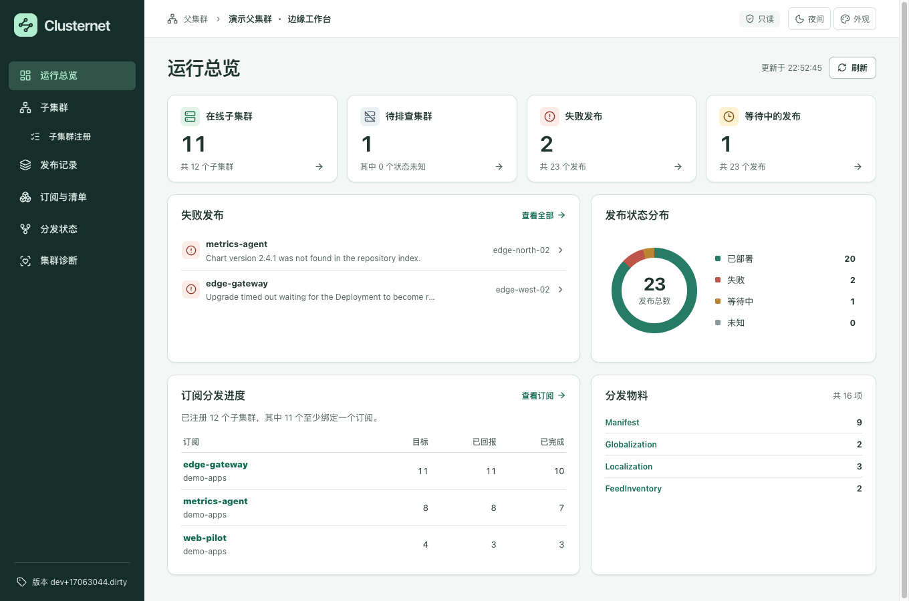
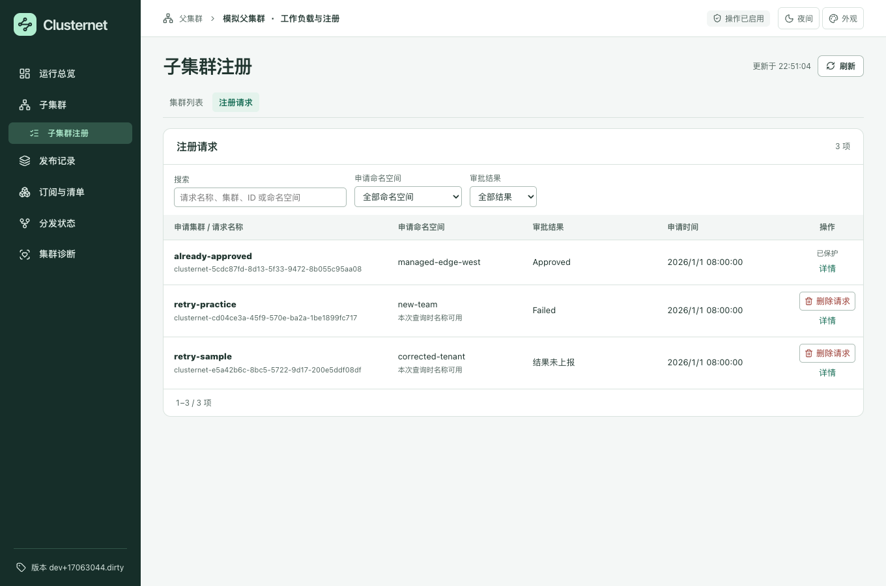
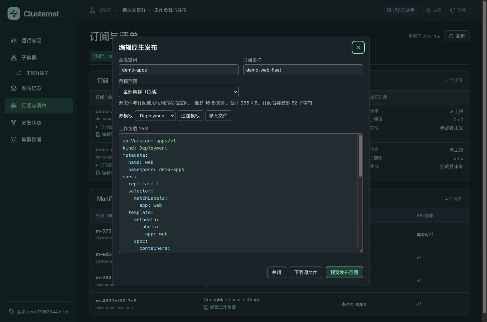
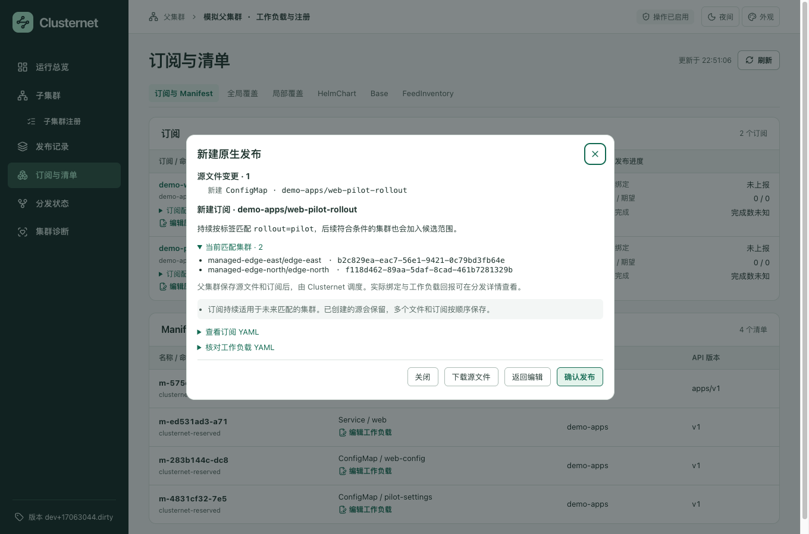

# Clusternet Dashboard

[English](README.md) · **简体中文**

Clusternet Dashboard 是面向 [Clusternet](https://github.com/clusternet/clusternet) 父集群的轻量运维面板。可以查看集群健康和分发进度，发布 Helm Chart 或原生 YAML，处理失败的发布及注册请求。面板默认只读，各项写操作可独立开启。

通过面板可以排查以下问题：

- **子集群是否就绪？** 查看就绪条件、心跳上报周期、健康探针和最近上报的节点容量。
- **订阅分发到了哪里？** 查看目标集群、分发进度，以及每个目标对各项订阅资源（Feed）的回报。
- **Helm 发布为什么失败或一直等待？** 查看 HelmRelease 的状态，以及所属 Description 记录的阶段和原因。
- **控制面是否正常？** 查看 Clusternet API 资源、控制面 Deployment 的状态条件，以及面板读取各类资源的权限。
- **集群如何注册，哪些配置会下发给它？** 查看注册审批结果、订阅的标签选择器、分发资源和覆盖规则。

## 界面预览

以下截图均来自模拟环境。总览中，12 个子集群有 11 个在线，23 个 Helm 发布有 2 个失败。同一页可以看到失败的发布名称、上报原因和各订阅的分发进度。



<details>
<summary>查看子集群注册请求</summary>

可按申请命名空间或审批结果筛选。已批准的请求显示为「已保护」，符合撤销条件的失败请求可以从列表中删除。



</details>

<details>
<summary>在 YAML 编辑器中修改 Deployment</summary>

图中的 Deployment 通过订阅持续分发到全部子集群。编辑器支持语法高亮，出现语法错误时可以点击行列号定位。



</details>

<details>
<summary>发布前核对哪些子集群会收到变更</summary>

准备新建 ConfigMap 时，预览列出当前匹配 `rollout=pilot` 的两个集群。以后带有该标签的新集群也会进入分发候选范围。



</details>

## 安全与权限

浏览器向面板后端请求数据。Kubernetes 凭证保存在后端，由后端访问 Kubernetes API。本地开发使用 kubeconfig，部署在集群内时使用 ServiceAccount。

Helm Chart 默认配置只读 RBAC。启用标签编辑会授予 ManagedCluster 的 `patch` 权限。启用发布跟进会授予部署命名空间中一个指定 ConfigMap 的 `get` 和 `patch` 权限。启用版本修改会授予跨命名空间的 HelmChart `patch` 权限。启用失败发布删除会单独授予跨命名空间删除单个 HelmRelease 的 `delete` 权限，不授予 `deletecollection`。部署 Chart 的独立开关会授予 Subscription 的 `create` 权限。原生 YAML 发布和注册请求撤销也有各自的 RBAC 开关。同一部署的所有访问者共用这套 Kubernetes 身份，请通过网关将每项已开启的操作限定给有相应权限的人员。详见[安全政策](SECURITY.md)。

当前版本未内置用户认证。请将面板部署在 VPN、私有 Ingress 或具备身份认证的网关后面。通过公网提供访问时，请先配置身份认证。

## 使用 Helm 安装或升级

将 kubeconfig 切换到目标 Clusternet 父集群。OCI Chart 默认使用配套镜像 `docker.io/changxuan/clusternet-dashboard:v0.2.0`。首次安装和升级使用同一条命令，升级时请沿用原有的 release 名称和命名空间。

```bash
helm upgrade --install clusternet-dashboard \
  oci://registry-1.docker.io/changxuan/clusternet-dashboard \
  --version 0.2.0 \
  --namespace clusternet-system --create-namespace
```

**已有自定义配置时**，在升级命令中添加 `--reset-values -f dashboard-values.yaml`，将核对过的配置应用到新版 Chart 的默认值上。可用 `helm get values clusternet-dashboard -n clusternet-system -o yaml` 查看原有覆盖项。移除旧的 `image.tag` 覆盖项可让 Helm 使用与 Chart 配套的镜像。

默认 Service 类型为 ClusterIP。运行端口转发后，即可[打开本地面板](http://localhost:8080/clusternet/)。

```bash
kubectl -n clusternet-system port-forward svc/clusternet-dashboard 8080:80
```

如使用私有 Ingress，将以下设置写入配置文件，用 `-f dashboard-values.yaml` 加载，并将 `nginx` 替换为实际的 IngressClass。

```yaml
ingress:
  enabled: true
  ingressClassName: nginx
  path: /clusternet
```

从发布版本的源码安装时，把 OCI 地址替换为 `./charts/clusternet-dashboard`，移除 `--version`。源码 Chart 已固定使用配套的发布镜像。[Chart 默认配置](charts/clusternet-dashboard/values.yaml)

### 父集群显示名称与可选操作

测试开发版本时，请使用同一源码版本的 Chart 与镜像。

```yaml
env:
  parentClusterName: "Operations hub"
labelEditing:
  enabled: false
releaseOperations:
  triage: false
  chartVersionEditing: false
  deleteFailedRelease: false
  deployCharts: false
  editChartSources: false
  publishNativeWorkloads: false
registrationOperations:
  deleteFailedRequests: false
```

本地运行时，顶栏显示选用的 kubeconfig context。设置 `KUBE_CONTEXT` 可以为当前面板进程指定 context，保留 kubectl 当前使用的 context。部署到集群内时，默认显示「集群内连接」，可通过 `env.parentClusterName` 改成团队熟悉的名称。侧栏显示正在运行的程序版本：发布构建显示镜像的发布标签，源码开发构建显示开发版本标识。

开启编辑后，在「子集群」中选择「编辑标签」即可新增、修改或删除标签。改动标签可能改变与该集群匹配的订阅和覆盖规则。保存时，面板会核对对象 UID 及本次所改标签的原值。如果其他人修改了同一标签，请重新载入，核对后再保存。

按需将上面的开关设为 `true`。本地运行二进制时，对应的环境变量分别为 `ENABLE_LABEL_EDITING`、`ENABLE_RELEASE_TRIAGE`、`ENABLE_CHART_VERSION_EDITING`、`ENABLE_FAILED_RELEASE_DELETION`、`ENABLE_CHART_DEPLOYMENT`、`ENABLE_CHART_SOURCE_EDITING`、`ENABLE_NATIVE_PUBLISHING` 和 `ENABLE_FAILED_REGISTRATION_DELETION`。

- **失败发布跟进**。在「发布记录」打开失败记录，将本次故障标记为「处理中」「已处理」，或重新打开。团队成员可在失败列表中按跟进状态筛选。状态保存在专用 ConfigMap，Helm 工作负载继续按原配置运行。新上报且可区分的故障从「待跟进」开始。
- **删除失败发布以重新部署**。在「发布记录」打开失败对象，核对目标集群、命名空间和发布名称后确认。面板对选中的 HelmRelease 提交普通 Kubernetes 删除请求，finalizer 可能卸载目标集群中的工作负载，造成服务中断。提交前，面板会重新检查发布仍为失败状态、控制它的 Description 正常存在且 UID 与所有者引用匹配，并且仍声明该 Chart。
- **查看 HelmChart 影响范围与更改版本**。只读工作区中，打开「订阅与清单 → HelmChart → 查看影响范围」可查看所有直接引用的订阅、各自已上报的绑定数和去重后的目标标识。启用版本编辑后，「更改 Chart 版本」会展示同一份预览，并支持确认新版本。保存会更新源 HelmChart 的 `spec.version`，健康集群也可能升级。请先确认仓库中存在该精确版本，保存后在发布记录中核对部署结果。调度和覆盖规则仍会影响最终下发范围和配置。

- **从 HelmChart 部署**。在「订阅与清单 → HelmChart」选择源 Chart，输入订阅名称（最长 52 个字符），选择以下一种目标范围，预览后确认。面板会在源 Chart 所在的命名空间创建一个 Replication 订阅，子集群的安装命名空间取自 Chart 的 `spec.targetNamespace`。
  - **指定集群**保存此次选中的集群 ID。批量选中筛选结果同样会固定这份名单。
  - **按标签持续分发**保存 Kubernetes 标签条件，例如 `env=prod,region in (east,west)`。后续注册或标签变更后符合条件的子集群会进入调度范围。
  - **全部子集群**使用空的 `clusterAffinity: {}`，覆盖当前和未来的子集群。动态规则允许当前匹配数为 0。预览会检查可能争用同一 Helm 发布的订阅，包括未来可能相交的规则。

  预览支持查看和下载即将创建的 Subscription YAML。如果没有可调度的目标，控制器可能报告 FailedScheduling；已安装应用的去留需核对实际绑定与发布记录。打开新建订阅可核对创建结果、实际绑定和各个 Feed 的回报，再到发布记录查看每个目标的 HelmRelease 阶段。同名订阅需要换名。若已有订阅或 HelmRelease 占用同一子集群里的同一 Helm 发布，请核对原发布或调整目标集群。即使源 Chart 位于不同的父集群命名空间，只要 Chart 同名、子集群和安装命名空间相同，两个订阅也可能争用同一个 Helm 发布。上游 v0.14.0 还要求目标集群开启 AppPusher 才能生成 HelmRelease。[v0.14.0 的部署条件](https://github.com/clusternet/clusternet/blob/v0.14.0/pkg/hub/deployer/helm/helm.go#L219-L246) · [v0.18.1 的 Chart 查找与校验](https://github.com/clusternet/clusternet/blob/v0.18.1/pkg/controllermanager/deployer/deployer.go#L760-L782)

**新建与编辑部署文件**

本地工作负载草稿、原生发布和 HelmChart 配置编辑器均提供 YAML 语法高亮。点击错误提示中的行列号可跳到出错位置，修正语法后可预览发布范围。超过 256 KiB 的本地草稿仍可点「校验 YAML」手动检查，或点「下载 YAML」保存原文。

启用 `releaseOperations.editChartSources` 后，在 HelmChart 列表点「新建 HelmChart」或某行的「编辑配置」。可从模板开始、导入 YAML，或下载当前编辑内容。支持 HTTP(S)/OCI 仓库、Chart 名称、固定版本、安装命名空间、超时及常用安装选项。预览会列出逐字段差异、直接引用此 Chart 的订阅和已上报绑定数。即使是新建 Chart，也可能满足一个已有订阅的 Feed。确认后写入父集群。已有凭证引用和其他未纳入编辑器的字段会保留。

**原生工作负载发布**。开启 `releaseOperations.publishNativeWorkloads`（二进制为 `ENABLE_NATIVE_PUBLISHING=true`），即可从「订阅与清单」新建 Deployment、Service、ConfigMap，或从清单及订阅列表打开已有配置。一次发布可包含同一命名空间内的多个 YAML 文档。可以选择全部集群、点选已注册集群的标签，或输入 Kubernetes 标签表达式。预览源文件变更、订阅规则和当前匹配集群后，再确认发布。需要目标命名空间时，请在子集群中事先准备。NodePort、LoadBalancer 类型的 Service 由目标集群分配地址和端口，Headless Service 可以指定 `clusterIP: None`。关闭发布开关时仍可在本地编辑和下载 YAML。

发布通过父集群的 Shadow API 保存模板，再创建或更新 Replication 订阅。修改已被订阅的模板可能马上触发既有分发；跨对象写入可能只完成一部分。遇到部分完成或连接中断，请核对回执和资源列表，再重新预览。成功回执表示父集群已记录配置，后续可在「分发状态」核对绑定和每个 Feed 的回报。[Clusternet Shadow API](https://clusternet.io/docs/user-guide/clusternet-shadow-api/)

**子集群注册**。侧栏「子集群注册」直接打开请求列表。按申请命名空间或审批状态过滤，可对照申请的命名空间、已分配命名空间及当前占用情况。注册请求本身是集群级资源。

开启 `registrationOperations.deleteFailedRequests`（二进制为 `ENABLE_FAILED_REGISTRATION_DELETION=true`）后，可撤销失败、拒绝，以及明确指定命名空间且仍未批准的请求。先核对并修正子端配置或命名空间冲突，再点击该行「操作」列的「删除请求」，输入请求全名确认。看台重新读取请求身份和分配记录后，仅删除这一条请求。已批准、已关联专属命名空间或 ManagedCluster 的请求会受到保护。

删除后可按 cluster ID 查找新请求。上游 v0.14.0、v0.18.1 的 agent 在等待批准期间会轮询旧请求；若删除后没有新请求，需要由子集群运维让 agent 重新进入注册流程，例如修正配置后重启 agent。同名请求的新 UID 表示新一轮申请，最终以 Approved 及对应 ManagedCluster 为准。[上游注册说明](https://clusternet.io/docs/tutorials/cluster-management/checking-cluster-registration/)

写入接口接受来自回环地址或已配置主机名的同源 JSON 请求。Chart 会将所配置的 Ingress 主机名加入已启用功能的允许列表。如果通过其他网关访问，请用 `labelEditing.allowedHosts` 配置标签编辑的主机名，用 `releaseOperations.allowedHosts` 配置发布操作、原生 YAML 发布和注册请求撤销的主机名。本地运行二进制时，对应环境变量分别为 `LABEL_EDITING_ALLOWED_HOSTS` 和 `WORKSPACE_WRITE_ALLOWED_HOSTS`。网关需保留请求的 `Host` 头。

## 如何贡献

[报告问题](https://github.com/chxcode/clusternet-dashboard/issues)时，请注明面板版本、复现步骤、预期结果和实际结果。提交代码或文档改动前，请先阅读[贡献指南（英文）](CONTRIBUTING.md)。

- [在本地运行面板](CONTRIBUTING.md#run-the-dashboard-locally)。有 Clusternet 集群时可以查看真实数据，没有集群时也能启动面板。
- [验证改动](CONTRIBUTING.md#verify-your-change)，然后向 `main` 分支[提交 Pull Request](CONTRIBUTING.md#open-a-pull-request)。
- 维护者可按[发布指南（英文）](docs/releasing.md)发布并验证版本。推送版本标签会触发工作流，向 Docker Hub 发布多架构镜像和 OCI Helm Chart。

如发现疑似安全漏洞，请按照[安全政策（英文）](SECURITY.md)私下报告。

## API 接口

以下路径相对于 `BASE_PATH`，默认前缀为 `/clusternet`。只读权限即可查看 HelmChart 影响预览。各项写操作和源文件读取分别由对应功能开关控制。

```text
GET /api/health
GET /api/context
GET /api/namespaces
GET /api/events
GET /api/clusternet/resources
GET /api/clusters
GET /api/registrations
DELETE /api/registrations/{name}
POST /api/native-sources/{namespace}/{name}/{kind}
POST /api/native-workloads/{namespace}/{name}/source
POST /api/native-workloads/{namespace}/{name}/preview
POST /api/native-workloads/{namespace}/{name}/apply
PATCH /api/clusters/{namespace}/{name}/labels
GET /api/subscriptions
GET /api/subscriptions/{namespace}/{name}
GET /api/manifests
GET /api/globalizations
GET /api/localizations
GET /api/feedinventories
GET /api/helmcharts
GET /api/helmcharts/{namespace}/{name}/version-impact
POST /api/helmcharts/{namespace}/{name}/version
POST /api/helmcharts/{namespace}/{name}/deployment-preview
POST /api/helmcharts/{namespace}/{name}/deployments
POST /api/helmcharts/{namespace}/{name}/source
POST /api/helmcharts/{namespace}/{name}/source-preview
POST /api/helmcharts/{namespace}/{name}/source-save
GET /api/bases
GET /api/helmreleases
DELETE /api/helmreleases/{namespace}/{name}
GET /api/release-triage
POST /api/helmreleases/{namespace}/{name}/triage
GET /api/helmrelease-events?namespace={namespace}&uid={uid}
GET /api/description-status?namespace={namespace}&name={name}&uid={uid}
GET /api/diagnostics
```

提交跟进状态时传入 `uid`、`incident`、`before` 和 `state`。其中 `incident` 取失败 HelmRelease 返回的 `triageIncident`，状态可选 `open`、`investigating`、`resolved`。更改版本时，先从影响预览读取 `uid`、`currentVersion` 和 `fingerprint`，再附上 `newVersion` 提交。遇到 HTTP 409 时，请重新读取并确认。

向 `deployment-preview` 提交 `name` 和 `targetMode`。固定模式 `fixed` 传 `targets`（各含 namespace、name、uid），标签模式 `selector` 传 `selector` 字符串，全部模式 `all` 只传模式和名称。预览返回当前匹配、规则和冲突。确认时将预览指纹加入原请求体并提交到 `deployments`。HTTP 201 表示父集群已记录部署意图。

源配置接口仅在开启编辑时可用。向 `source` 提交 `{}` 读取可编辑的 YAML、UID 和资源版本。向 `source-preview` 提交 `mode`（`create` 或 `edit`）及 `yaml`，编辑时附上刚读取的 `uid` 和 `resourceVersion`。核对字段差异与引用后，将原请求和 `fingerprint` 提交至 `source-save`。发生冲突时重新核对源版本。

删除请求的 JSON 需包含选中 HelmRelease 的 `uid` 和 `resourceVersion`，两者均为字符串，并作为 Kubernetes 删除的前置条件。收到 HTTP 202 表示删除已受理。请刷新发布记录，按相同命名空间和名称查找新 UID 的对象，跟踪其阶段是否变为 `deployed`，并核对目标集群中的工作负载。

## 运维排查

- 在「运行总览」查看集群与发布数量。点击「失败发布」可打开已筛选的列表，再选择一条发布记录查看控制器回报和关联资源。「刷新」会重新加载当前视图。
- 在「订阅与清单」查看每个订阅的分发方式。`Replication` 给每个选中的目标分发完整应用，`Dividing` 按静态权重或动态调度策略在目标间分摊工作负载副本。打开订阅的分发详情可对照已注册数、标签匹配数和调度器回报的绑定数，并展开匹配标签但未列入绑定的集群名单。「运行总览」展示跨订阅去重后的已绑定集群数。[Clusternet 多集群调度策略](https://clusternet.io/docs/tutorials/multi-cluster-apps/)
- 在「子集群」筛选「状态未知」，展开「查看诊断」可看到控制器给出的原因、最近状态观测时间及资源快照。总容量和可分配量来自最近一次上报；实时利用率需要单独的指标数据源。
- 发布筛选条件与当前选择的订阅会保存在页面 URL 中，便于分享排查位置。打开发布详情时，面板通过命名空间、名称和 UID 读取所属 Description 的状态，分别展示 HelmRelease 和 Description 的回报。父集群事件可能已过保留期。
- **失败发布如何恢复？** 上游 Clusternet v0.14.0 至 v0.18.1 会跳过仅更新普通注解的 HelmRelease。正常删除时，无论是否启用 `atomic`，部署器都会先调用 Helm 卸载，再移除 finalizer。对象实际删除后，所属 Description 会收到事件。如果它仍声明该 Chart 且控制器可用，便可重建发布。v0.14.0 在这条创建路径上还要求目标集群启用 AppPusher。如果控制器已判定集群失联，可能直接移除 finalizer，在子集群留下工作负载。[v0.14.0 的创建条件](https://github.com/clusternet/clusternet/blob/v0.14.0/pkg/hub/deployer/helm/helm.go#L219-L245) · [v0.18.1 的更新过滤器](https://github.com/clusternet/clusternet/blob/v0.18.1/pkg/controllers/apps/helmrelease/helmrelease.go#L75-L94) · [卸载流程](https://github.com/clusternet/clusternet/blob/v0.18.1/pkg/utils/deployer.go#L145-L159) · [所有者收到删除事件](https://github.com/clusternet/clusternet/blob/v0.18.1/pkg/controllers/apps/description/description.go#L106-L133) · [失联集群的处理](https://github.com/clusternet/clusternet/blob/v0.18.1/pkg/controllermanager/deployer/helm/helm.go#L403-L410)
- 较早版本的 Clusternet 可能不提供 `status.completedReleases`。此时页面展示已观测到的回报，完成数显示为未知。
- 面板是可选组件，可独立于 Clusternet 核心组件升级。

## 致谢

感谢每一位为面板提出建议、测试功能、完善文档或贡献代码的人。我们在项目最初的设计与实现中使用了 [Hermes Agent](https://github.com/NousResearch/hermes-agent)，后续开发也得到了 Codex 的协助。欢迎贡献者选择适合自己的工具和模型参与项目。

## 许可证

本项目采用 Apache License 2.0，详见 [LICENSE](LICENSE)。
